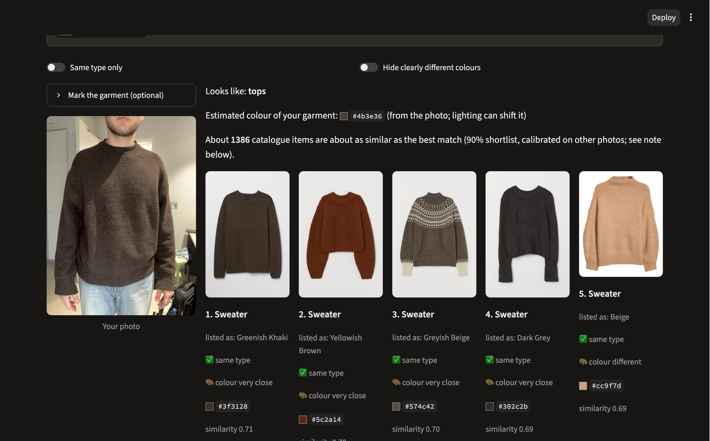
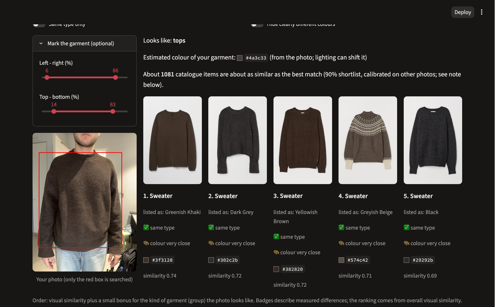
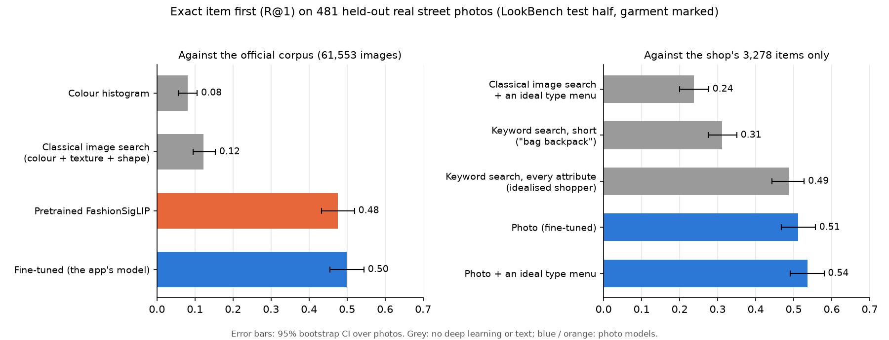
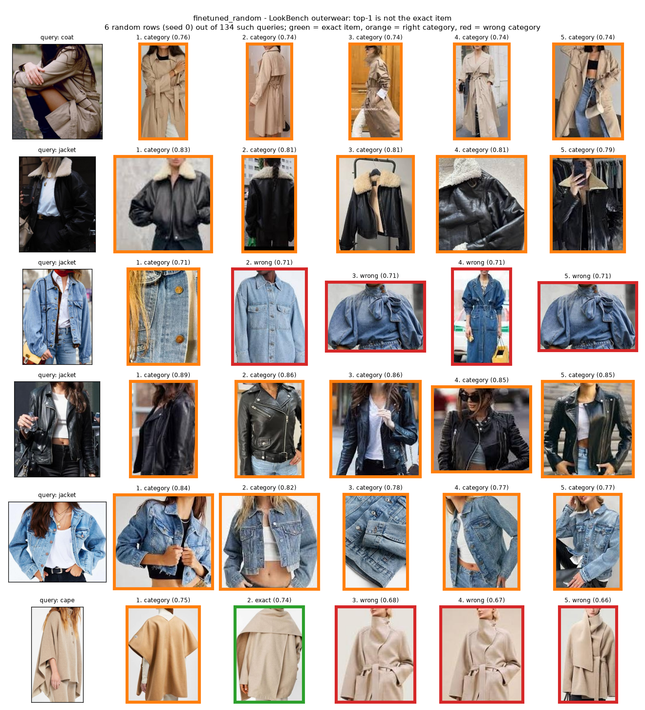
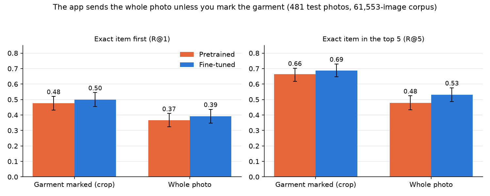
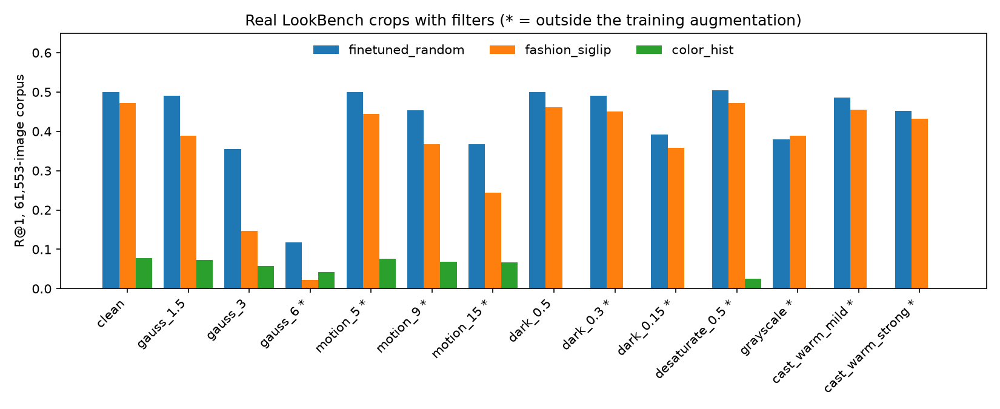
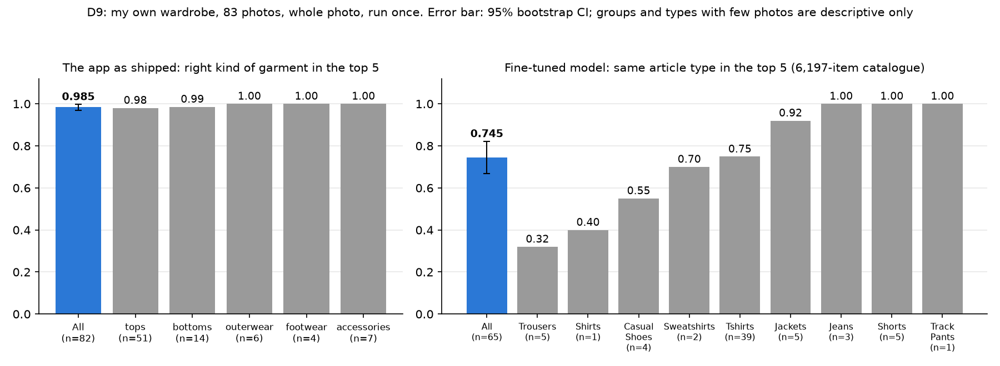
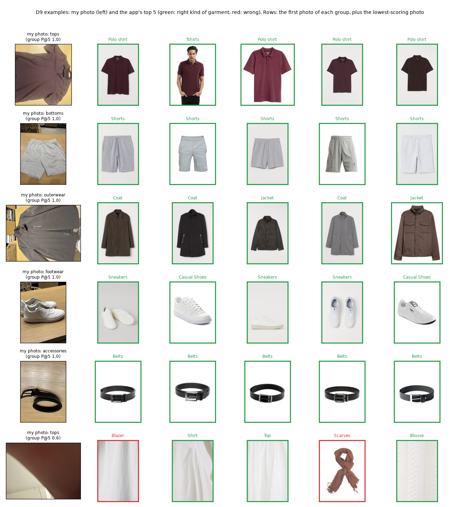

# DAYFIT: find a garment from a photo

You see a jacket on someone in the street, or a pair of jeans in a photo, and you can't describe it well
enough to search for it. DAYFIT lets you search with the photo instead: upload it, and you get the five
most similar items from a shop's catalogue. Each result is labelled with what was measured (kind of
garment, colour) so you can judge the matches yourself, and the app warns you when the photo shows something
the shop doesn't sell.

Course project for EECE 490 (Machine Learning), American University of Beirut, Fall 2026.
`report/results_log.md` is my lab notebook.

**Results at a glance**
- **On real street photos** (LookBench test half, 481 photos, 61,553 images to search), the fine-tuned photo
  model puts the exact item first for 50% of photos, 4 times as often as a classical image search (12%).
  Against the shop's 3,278 items alone it gets 51%, against 31% for a short typed search; only an idealised
  shopper who types every attribute in the shop's own words ties it (49%).
- **Photo quality matters more than the model.** Sending the whole photo instead of marking the garment drops
  this to 39%. Fine-tuning helps little on clean photos (+2 points, not significant on the test half) and a lot
  on blurred ones (+6 to +21 points).
- **On my own wardrobe** (83 garments, the final untouched test), the app as shipped puts the right kind of
  garment in the top 5 for 98.5% of photos. The exact article type is harder: on the evaluation catalogue the
  fine-tuned model gets it for 75% (trousers often come back as track pants).
- **What doesn't work:** a learned re-ranker (+2 points, not significant) and the "not sure" message, which
  fired on 47% of my wardrobe photos without telling good results from bad ones.
- The model was chosen before the test split was frozen, so one comparison is slightly optimistic; details
  under "How these photos were used".

**Who it is for.** The user is an online shopper; the system would run as a "search by photo" feature on
one shop's site, so it can only suggest what that shop sells. **How it is done today:** on a shop's own
site, with text search and menu filters (garment type, colour), which needs the shopper to name what they
see; outside the shop, with general photo-search tools such as Google Lens, which search the whole web
rather than one shop's stock. I compare against keyword search, menu filters and a classical
(non-deep-learning) image search; I did not compare against general photo-search tools.



*My own sweater, which is not in the catalogue. Top: the whole photo. Bottom: the same photo with the
garment marked (only the red box is searched). Both find similar brown knit sweaters and put the same one
first; marking the garment makes the matches tighter.*

## Results on real photos

All numbers below are on **real street photos** (LookBench `real_streetlook`): the 481 photos of the test
half of a 500 / 481 split (photos of the same street picture or item kept on one side).

**How these photos were used, honestly.** I chose the app's model (fine-tuned with random batches, rather than
same-type batches, the pretrained model or an ensemble) on **all 981** LookBench photos, *before* I froze the
split (Findings 5-7). So the test half is clean for everything decided after the split (the group bonus,
DINOv2 and colour fusion, the re-ranker, the classical and keyword baselines): each was tuned on the dev half
only and run once on the test half. It is **not** clean for the choice of the model itself, so the fine-tuned
vs pretrained comparison below is slightly optimistic. The final untouched check is my own photos (D9), with
rules fixed before any photo was taken, run once on Nov 23 (results below the bad-photo table).

Two questions, two metrics:

- **Right kind of garment in the top 5 (group P@5)**: the main metric of the approved proposal ("show me
  things like this"), target 0.90.
- **Exact item first (R@1)**: a harder question I added, "is this the very item in the photo?".

I report both, but lead with R@1, because group P@5 turned out to be nearly free for the alternatives: a
typed category reaches 0.98 and a type menu 1.0 by construction (second table). So group P@5 cannot show
that a photo adds anything; R@1 can.

**Against the benchmark's official corpus of 61,553 images** (the 3,278 shop items + 58,275 distractors):

| Method | Exact item first (R@1) | Exact item in top 5 (R@5) |
|---|---|---|
| Colour histogram (background masked) | 0.081 | 0.123 |
| Classical image search: colour + texture (LBP) + shape (HOG), weights tuned on the other half | 0.123 | 0.162 |
| Pretrained FashionSigLIP, no training | 0.476 | 0.663 |
| **Fine-tuned FashionSigLIP (the app's model)** | **0.499** | **0.688** |
| Fine-tuned + learned re-ranker trained on 500 real photos | 0.520 (+2.1, not significant, p = 0.12) | 0.709 |

**Against the 3,278 shop items only** (needed for anything that uses item text or type labels, which the
distractors do not have):

| Method | Exact item first (R@1) | Right kind of garment in top 5 (group P@5) |
|---|---|---|
| Classical image search + an ideal type menu | 0.237 | 1.0 (by construction) |
| Keyword search, short ("bag backpack"), BM25 | 0.312 | 0.983 |
| Keyword search, every attribute in the shop's own words (idealised shopper) | 0.486 | 0.986 |
| **Fine-tuned FashionSigLIP (photo only)** | **0.511** | **0.871** |
| Fine-tuned + an ideal type menu | 0.536 | 1.0 (by construction) |
| Fine-tuned + group bonus (the app's ranking) | 0.509 | 0.905 |



What these show:

- **A photo beats every realistic alternative that does not need the shopper to describe the garment.** The
  photo model finds the exact item first 4 times as often as a classical image search (0.50 vs 0.12) and
  clearly more often than a short typed search (0.51 vs 0.31). Only an idealised shopper who types every
  attribute in the shop's own words ties it (0.49 vs 0.51, no significant difference); real shoppers cannot
  do that, which is the problem the app solves. The honest pitch is not "photos beat text" but "a photo
  matches a perfect description without the shopper having to write one".
- **On the proposal's metric the photo alone loses to a menu.** The photo model puts the right kind of garment
  in the top 5 for 0.87 of photos; a typed category gets 0.98 and a menu 1.0. The app's group bonus (adding
  `0.05 * P(item's group | photo)` from a zero-shot type classifier) raises this to 0.905, which meets the
  proposal's 0.90 target on held-out photos, at no significant cost in R@1 (0.509 vs 0.511). The bonus is
  aimed at this metric fairly directly. Photo + an ideal type menu chosen by the shopper does better on both
  (0.536 / 1.0); the app has no such menu, only a *same type only* filter based on the predicted type.
- **Fine-tuning helps a little on clean photos and a lot on blurred ones.** On clean real crops it adds +2.3
  points R@1 over the pretrained model on the test half, which is **not significant** there (p = 0.07; on all
  981 photos +2.9, p = 0.001, but those include the photos the model was chosen on). On whole photos it adds
  +2.5 points (test half, p = 0.04). Its clearest value is robustness to blur: on blurred real photos it adds
  +6 to +21 points, including motion blur, which it never saw in training (table below). For colour changes it
  never saw (black-and-white, coloured light) it adds no more than on clean photos.
- **A learned re-ranker on real photos does not help significantly yet.** Trained on 500 labelled street
  photos with 9 features (similarities of three models, small-patch matching, colour, garment-type agreement),
  it gains +2.1 points, not significant. Its learning curve is still rising at 500 photos (50 photos: worse
  than no re-ranker); adding 1,011 studio photos did not help. Most misses are the right kind of garment with
  the wrong design, and the re-ranker mostly re-weighs the two models' similarities.
- **A 19 times bigger corpus costs only about 2 points** (0.520 -> 0.501 on all 981 photos): the distractors
  rarely beat the true item.

### Where it fails

On the dev half, 87% of the misses (206 of 236) already have the right kind of garment first, just not the
right design: the model finds "a black leather jacket with a shearling collar", not *that* jacket (Finding 31).
And 97 of the 236 misses do not have the true item in the top 20 at all, so no re-ranking can fix them;
that needs a better embedding, for example training on real street-to-shop pairs, which I did not do.


*Six random outerwear photos whose first result is not the exact item (orange: right category, red: wrong
category, green: the exact item). The results are near-identical coats and jackets. Some "wrong" ones are
arguably fine (wrap coats for a cape), and one row shows the same gallery picture more than once.*

### The app's real setting: whole photos and bad photos

LookBench photos are hand-drawn crops of the garment. **The app sends the whole photo unless you mark the
garment**, and that is much harder (official corpus, test half):

| Photo sent | Exact item first (R@1) | Exact item in top 5 |
|---|---|---|
| Garment marked (crop) | 0.499 | 0.688 |
| Whole photo (person, background, other clothes) | 0.391 | 0.530 |



Marking the garment matters more than any model change I tried, so the page now recommends it. The same holds
for the proposal's metric: on whole photos the right kind of garment is in the top 5 for only 0.68 of photos
(test half, without the group bonus; the bonus was not measured on whole photos), so the 0.905 above is a
**crop** number.

None of the LookBench numbers are measured on the app's own 54,178-item catalogue: LookBench's target items
are not in it, so exact-item R@1 cannot be measured there. My own-photo test (D9, below) is the check of the app
as shipped.

Bad photos (all 981 real crops, so including the dev photos and the photos the model was chosen on; fixed
filters; * = outside the training augmentation; differences Holm-corrected over the 14 filters):

| Filter | Fine-tuned R@1 | Pretrained R@1 | Fine-tuned minus pretrained |
|---|---|---|---|
| none | 0.501 | 0.472 | +2.9 |
| blur, radius 1.5 / 3 / 6* px | 0.490 / 0.355 / 0.118 | 0.389 / 0.147 / 0.022 | +10.1 / +20.8 / +9.6 |
| motion blur 5* / 9* / 15* px | 0.501 / 0.454 / 0.368 | 0.444 / 0.368 / 0.244 | +5.6 / +8.6 / +12.4 |
| brightness x0.5 / x0.3* / x0.15* | 0.501 / 0.490 / 0.391 | 0.461 / 0.451 / 0.358 | +4.0 / +4.0 / +3.4 (last n.s.) |
| grayscale* | 0.379 | 0.388 | -0.9 (n.s.) |
| warm colour cast, mild* / strong* | 0.485 / 0.452 | 0.456 / 0.432 | +3.0 / +1.9 (n.s.) |



### My own wardrobe: the final untouched check (D9)

83 photos, one per garment I own (39 t-shirts, 9 sweaters, 2 hoodies, a shirt, 14 bottoms, 6 jackets/blazer,
4 pairs of shoes, 7 accessories, a wallet), taken in one session with my phone, whole photo, no editing. The
rules, the frozen model and my expected result (0.70-0.90) were written before any photo was taken; labelled by
hand and checked before the single run (Finding 46).

| Result | Value [95% CI] | Photos |
|---|---|---|
| **The app as shipped** (54,178-item catalogue + group bonus): right kind of garment in the top 5 | **0.985** [0.968, 0.998] | 82 |
| Fine-tuned model, evaluation catalogue: same article type in the top 5 | 0.745 [0.668, 0.822] | 65 |
| Pretrained FashionSigLIP, same | 0.711 | 65 |
| Colour histogram, same | 0.092 | 65 |




*Rows chosen by a fixed rule, not by looking: the first photo of each group (in file order) and the photo with
the lowest score. Green: right kind of garment, red: wrong.*

- **Higher than I expected**, because a garment laid flat or on a hanger filling the frame looks much like a
  shop's product photo. This does not contradict the low whole-street-photo numbers above: it is the easy case.
- **The type is harder than the group.** Jeans, shorts and jackets are almost always right; trousers are mostly
  matched with track pants (0.32) and casual shoes with sports shoes (0.55): right group, wrong type.
- The group badge appeared for 92% of photos and was right every time; the out-of-catalogue warning fired once,
  on the wallet, and on none of the 82 garments the shop sells. "Not sure" did not work here (see below).

## What the app shows

For each photo:

- **The 5 closest catalogue items.** The ranking comes from FashionSigLIP fine-tuned on the catalogue, plus a
  small bonus for items of the kind of garment the photo seems to show
  (`similarity + 0.05 * P(item's group | photo)`, tested on held-out real crops: same R@1, right kind of
  garment in the top 5 0.871 -> 0.905). Kids' items are hidden,
  and the same product photographed twice is shown only once.
- **A type badge** (`same type` / `different type`): which group the photo belongs to (tops, outerwear,
  bottoms, dresses, footwear, bags, accessories), guessed by the pretrained FashionSigLIP. It only appears
  when the guess is at least 90% confident; on real photos (LookBench crops) it then appears for 65% of photos and is right
  95% of the time.
- **A colour badge** and the photo's estimated colour, next to the shop's own colour name ("listed as").
  The estimate comes from the photo, so lighting moves it. When the photo has almost no colour (a
  black-and-white photo, or a black, white or grey garment) no colour badges are shown.
- **"Not sure"** when even the best match is weak, and a **shortlist size** (how many items are about as
  similar as the best one, a 90% conformal shortlist calibrated on real photos at the official-corpus scale).
  The page shows the size only when it is 50 or fewer; for a marked garment the honest 90% list is about 116
  items long, for a whole photo about 880. Both were calibrated on LookBench, not on the app's catalogue, so
  in the app the 90% is not guaranteed (the API's `note` says so). "Not sure" was calibrated on crops; on
  whole photos it fires for about half of them. On my own wardrobe (D9) it fired for 47% of photos while the
  results were just as good with or without it (0.984 vs 0.986), so on the app catalogue it is far too cautious,
  and the shortlist (median 1,552 items) is too long to show.
- **"This looks like a skirt; our catalogue has no skirts"** when the photo shows something the shop does
  not sell at all.
- Two optional filters, *same type only* and *hide clearly different colours*. They hide results; they
  never change the order.
- A **crop box** ("Mark the garment", recommended), done in memory.

The badges describe differences I measured; they are not the model's reasons. The order comes from
overall visual similarity.

## Two catalogues

| `DAYFIT_CATALOG` | Catalogue | Used for |
|---|---|---|
| unset (default) | `data/catalog.csv`: 6,197 items, 14 types | the synthetic-photo results and the tests |
| `app` | `data/app_catalog.csv`: **54,178 items**, 68 types | the demo |

The evaluation catalogue is Kaggle's Fashion Product Images. For the demo I wanted something closer to a real
shop, so the app catalogue adds 26,944 more adult items from the same dataset and 21,037 newer H&M products
(2018-20). Each H&M product type was mapped to one of the existing types before anything was run, so the
badges and the ranking bonus did not have to be recalibrated; the page still shows H&M's own name for the
product. The app hides 809 kids' items (by the shop's gender field and by product name, Finding 36).
`curl -s localhost:8000/health` tells you which catalogue is running.

## Privacy

Uploaded photos are **never stored**. The API reads the photo straight into memory (FastAPI's usual
`UploadFile` would write anything over 1 MB to a temporary file) and logs nothing about it.
`tests/test_api.py` checks that a search writes no file, and in Docker the API runs on a read-only file
system.

## Run it

### On your machine (Mac with Apple Silicon, or anything with Python 3.14)

```
python -m venv .venv
source .venv/bin/activate
pip install torch torchvision
pip install -r requirements.txt
DAYFIT_CATALOG=app uvicorn serving.api:app --port 8000
```

Without `DAYFIT_CATALOG=app` you get the evaluation catalogue. If the page behaves like an older version,
an old server is probably still running on port 8000: `lsof -ti :8000 | xargs kill -9`.

Then, in a second terminal:

```
source .venv/bin/activate
streamlit run serving/ui.py
```

and open http://localhost:8501. You need the catalogues and their images, the fine-tuned checkpoint
(`models/finetuned_random.pt`) and the saved indexes (`models/index/finetuned_random*`). These are
generated or downloaded, not stored in git (see "Reproduce").

### With Docker (CPU only)

```
docker compose up --build
```

The API is on http://localhost:8000/health and the page on http://localhost:8501. The image contains
both catalogues and serves the demo one (`DAYFIT_CATALOG=evaluation docker compose up` for the other).
The build stops early if the saved demo index does not match the catalogue, rather than spending a long
time re-embedding 54k images on the CPU. On a Mac without Docker Desktop, Colima works
(`brew install colima docker-compose`, then `colima start --cpu 4 --memory 8`). The image is built from
local files, so it currently needs the reproduction steps first.

### API

```
curl -X POST --data-binary @photo.jpg http://localhost:8000/search
```

returns JSON with the `results` (rank, item, score, type and colour badges, colour), the `query`
(predicted group, estimated colour or `colour_judged: false`, out-of-catalogue warning), `not_sure`,
`shortlist_size`, `latency_ms` and a `note` on the limitations.

**Response time.** Budget: at most 500 ms of server time per search on a 4-core CPU (about 1 s is the limit
for an answer to feel immediate, and the phone upload and page take roughly the other half). Measured: 266 ms
median in Docker on 4 vCPUs (Findings 26, 33); on the Mac's CPU with 4 threads 129 ms for the 54k-item app
catalogue, of which 56 ms is the second (type) model, and 36 ms on the Mac GPU (Finding 45). For slower machines
`DAYFIT_TYPE_MODEL=off` skips the type model (no type badge, no group bonus, no out-of-catalogue warning).

## Synthetic phone photos (secondary result)

Before real photos were available I built synthetic "phone photos" of the evaluation catalogue (random
background, rotation, crop, lighting, blur, JPEG). The fine-tuned model was **trained on the same kind of
synthetic photo**, so these numbers mostly measure how well it learned that augmentation: its gain over the
pretrained model is +15.6 points here (0.949 vs 0.793 on medium photos) and about +2 to +3 on clean real
photos (Findings 7, 38).

| Test (294 items, medium / strong photos) | Value |
|---|---|
| Exact item first (R@1) | 0.949 / 0.813 |
| Right article type among the other 5 (P@5) | 0.867 / 0.822 |


Other first-phase findings that still hold: same-type batches during fine-tuning made the model worse at
telling types apart and random batches fixed it (Findings 7-8); the conformal shortlist only keeps its 90%
promise on real photos if it is calibrated on real photos (Finding 10).

## Limitations

- The app can only return what the catalogue sells, so for many photos the best answer is "similar", not
  "the same". The exact item comes first about half the time on real crops, 39% on whole photos.
- The real-photo test is one benchmark (LookBench street photos, 981 photos, 621 independent groups); the
  95% confidence intervals are about +-4 to 5 points. The model itself was chosen on all 981 photos before the
  dev / test split existed, so the test half is only clean for what was decided afterwards (see "How these
  photos were used").
- **The app as shipped is measured only on my own wardrobe** (D9: 83 photos, one person, one session, 61%
  tops, no dresses or bags, garments on a plain surface). Those photos are easy; a shopper's photo of a
  garment someone is wearing in the street is closer to LookBench's whole photos (0.68 right kind of garment).
- **"Similar" is only measured as "same kind of garment".** For a photo of something the shop does not sell
  (the common case), the useful answer is a similar item, but the only measure of that here is group P@5,
  which a menu gets for free. Whether the top 5 actually look alike was not judged by people.
- Very blurry photos break every model (strong blur: R@1 0.12), and "not sure" catches few of them (it fires
  on 19% of such photos). Very dark photos often get a wrong "colour different" badge (27-33% for the true
  item even after the black-and-white fix).
- The keyword-search comparison is idealised (the shopper's words are the benchmark's own annotation) and runs
  on the 3,278 shop items only; in a bigger shop many items would share the same words.
- The learned re-ranker would need the candidates' small-patch features stored with the catalogue (about
  21 GB for 54k items), so it is not in the app.
- **Catalogue coverage and bias.** The base catalogue is Fashion Product Images (Indian e-commerce, 2011-12)
  and leans towards men's and older styles (none of its jeans are wide-leg, Finding 30). Women's and current
  styles depend mostly on the H&M items. H&M's own type labels are noisy (parkas filed as hoodies, jumpsuits
  as trousers, Finding 36), and some catalogue images are fabric close-ups or show the wrong product; I could
  not remove those reliably.
- Kids' items are hidden, not detected: a photo of a kids' garment gets the most similar adult items.
- The colour estimate looks at the middle of the photo, so with a whole photo it can pick up the background.
- **Licence.** Fashion Product Images, LookBench and the H&M data are for non-commercial research only.
  This is a research demo and cannot be sold with these images.

## Repository layout

```
data_prep/    build the catalogues (evaluation, app, H&M), synthetic phone photos, app clean-up
retrieval/    colour histogram, CLIP / FashionSigLIP retrievers, ensembles
training/     fine-tuning (contrastive, same-type or random batches)
evaluation/   metrics, bootstrap tests, LookBench (official corpus, whole photos, bad photos), baselines,
              re-ranker, conformal methods, analyses, own-photo test (D9)
serving/      search engine, calibration, badges, colour check, API, Streamlit page, latency
tests/        unit tests (metrics, statistics, conformal) and API tests
results/      saved result tables (CSV)
report/       results log and figures
```

## Reproduce

What is in git: code, saved summary tables (`results/*.csv`), figures and the LookBench dev/test split.
What is **not** in git (too big, or licensed): the datasets, their images, the fine-tuned checkpoint, the
saved indexes and the per-query result files (`results/perquery/`) that the test-half numbers above are
computed from. Everything below regenerates them. `tests/test_api.py` needs the evaluation catalogue, the
checkpoint and the saved synthetic results; on a fresh clone `python -m pytest` skips it and runs the other
tests.

1. **Data.**
   - Kaggle "Fashion Product Images (Small)": unpack `styles.csv` and `images/` into `data/raw/`.
   - Kaggle "Fashion Product Images Dataset" (full, high-resolution): save the zip as
     `data/raw_full/fashion-product-images-dataset.zip`.
   - LookBench: downloaded automatically from Hugging Face (`srpone/look-bench`); needs the evaluation
     packages: `pip install -r requirements-dev.txt`.
   - H&M (demo catalogue only): accept the Kaggle competition rules, then save the zip as
     `data/hm/h-and-m-personalized-fashion-recommendations.zip`.
2. **Model, catalogues and app** (in this order):

```
python -m data_prep.build_catalog
python -m data_prep.hires_catalog --zip data/raw_full/fashion-product-images-dataset.zip
python -m data_prep.make_queries
python -m training.finetune --hard_batches 0 --out models/finetuned_random.pt --log models/finetune_random_log.csv
python -m evaluation.run_eval --method finetuned_random
python -m evaluation.run_lookbench --subset real_streetlook --method finetuned_random
python -m serving.calibrate
python -m serving.badges
python -m serving.outside_check
python -m data_prep.app_catalog
python -m serving.app_badges_check
python -m serving.type_rerank
python -m data_prep.hm_catalog --from_zip data/hm/h-and-m-personalized-fashion-recommendations.zip
python -m data_prep.app_add_hm
python -m serving.colour_check
python -m data_prep.app_cleanup
```

3. **Real-photo experiments** (each script checks itself against a saved number and stops if it does not
   match; the test half is used once per method, see the pre-registrations in `report/results_log.md`):

```
python -m evaluation.lookbench_split
python -m evaluation.export_lookbench_features
python -m evaluation.fusion_lookbench --side dev
python -m evaluation.fusion_lookbench --side test --a 0   --w 0                 --save base
python -m evaluation.fusion_lookbench --side test --a 0   --w 0    --beta 0.02  --save colour
python -m evaluation.fusion_lookbench --side test --a 0.1 --w 0                 --save dinov2
python -m evaluation.fusion_lookbench --side test --a 0   --w 0.05              --save groupbonus
python -m evaluation.fusion_lookbench --side test --a 0.1 --w 0.05 --beta 0.02  --save combined
python -m evaluation.fusion_test_stats
python -m evaluation.run_lookbench --subset real_streetlook --method fashion_siglip
python -m evaluation.run_lookbench --subset real_streetlook --method finetuned_random --query_image raw_image
python -m evaluation.run_lookbench --subset real_streetlook --method fashion_siglip --query_image raw_image
python -m evaluation.whole_photo
python -m evaluation.lookbench_full
python -m serving.calibrate_full
python -m evaluation.robustness
python -m evaluation.keyword_baseline
python -m evaluation.classical_baseline
python -m evaluation.rerank_features
python -m evaluation.rerank_model
python -m evaluation.rerank_studio
python -m pytest
```

The H&M items are added after the badges, the out-of-catalogue threshold and the bonus were fixed; those
are not recomputed on the merged catalogue.

Data: Kaggle "Fashion Product Images" (catalogue), LookBench (`srpone/look-bench` on Hugging Face, real
photos and the 58,275 distractor images) and Kaggle "H&M Personalized Fashion Recommendations" (demo
catalogue only). Pretrained models: Marqo FashionSigLIP, FashionCLIP and DINOv2.

## Contributions

I wrote the code with the help of Claude (an AI assistant) and reviewed all of its outputs. The analysis is
mine.

## Documents

- `report/results_log.md`: the full lab notebook, with a one-page index at the top, every pre-registration
  and every result, including corrections and negative results. Later findings can overrule earlier ones;
  this README is the current summary.
