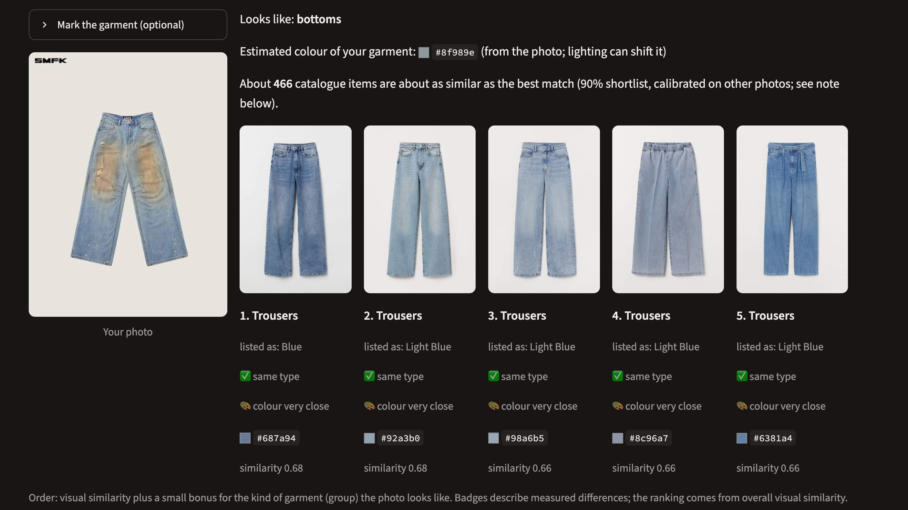
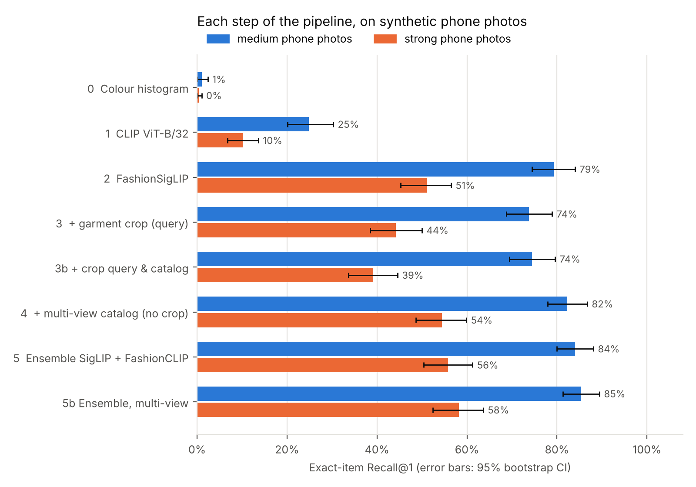
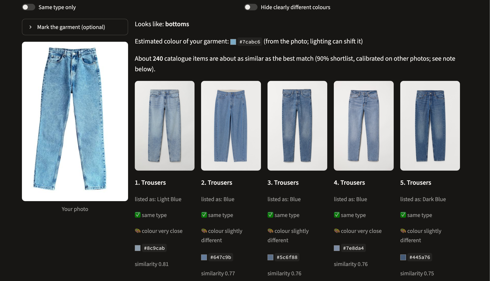

# DAYFIT: find a garment from a photo

DAYFIT is a visual clothing search. A shopper uploads a photo of a garment they saw and cannot
describe; DAYFIT returns the 5 most similar items of a catalogue, says when it is not sure, and
explains each result with measured badges (type, colour). Course project for EECE 490 (Machine
Learning), American University of Beirut, Fall 2026.


*The app on a photo of wide-leg jeans (not in the catalogue): the five closest items the shop sells, with
type and colour badges and the shortlist size.*

## What the app shows

For one photo:

- **Top 5 catalogue items**, ranked by visual similarity (a FashionSigLIP model fine-tuned on our
  catalogue with random batches; see "Results"). With the app catalogue, the order also adds a small
  bonus for the kind of garment the photo looks like (`similarity + 0.05 * P(item's group | photo)`),
  the version tested on held-out real photos; kids' items are hidden and repeated photos of the same
  product are skipped.
- **Type badge** (`same type` / `different type`): the photo's garment group (tops, outerwear,
  bottoms, dresses, footwear; plus bags and accessories with the app catalogue) predicted zero-shot by
  the *pretrained* FashionSigLIP. Shown only when the prediction is at least 90% confident (then correct
  for 98-99% of our synthetic test photos).
- **Colour badge** and **estimated colour** (hex code + swatch): the median colour of the image
  centre in CIELAB, compared with CIEDE2000. It is an estimate from the photo; lighting shifts it.
  Each result also shows the shop's own colour name ("listed as").
- **"Not sure"** when the best match is weak, and a **shortlist size** ("about N items are as similar
  as the best match"), both calibrated on real street photos (LookBench). They come from conformal
  methods, but the guarantees do not formally hold in the app, because the app searches a different
  catalogue than the one they were calibrated on (with 54k items the shortlist is often in the hundreds).
- **"This looks like a skirt; our catalogue has no skirts"** when the photo shows a kind of garment the
  catalogue does not sell (zero-shot check; on the evaluation catalogue it detects 92% of such real
  photos with 4% false alarms).
- Two optional filters (`Same type only`, `Hide clearly different colours`) that **hide** results;
  they never change the ranking.
- An optional **crop box** ("Mark the garment"): two sliders mark the garment so that the background and
  other clothes do not count. The crop is made in memory; with the default box the photo is sent unchanged.


*The author's own sweater, worn: whole photo (top) and with the crop box around the sweater (bottom; only
the red box is searched). The same item comes first in both; the crop box raises the top similarity
(0.71 -> 0.74), shrinks the shortlist (1,386 -> 1,081) and drops a beige sweater with a different colour.*

## Two catalogues

| `DAYFIT_CATALOG` | Catalogue | Used for |
|---|---|---|
| unset (default) | `data/catalog.csv`: 6,197 items, 14 types (Fashion Product Images) | **every reported number** and the tests |
| `app` | `data/app_catalog.csv`: **54,178 items**, 68 types | the demo |

The app catalogue has three parts: the 6,197 evaluation items, 26,944 more adult items from the full
Fashion Product Images dataset (2011-12; skirts, bags, hats, ...), and 21,037 H&M products (2018-20,
adult sections, at most 1,000 per product type). Each H&M product type was mapped, before running, to an
existing app type (e.g. Hoodie -> Sweatshirts), so the badges, the out-of-catalogue threshold and the
group bonus did not need recalibration; the page shows H&M's own type name. The app catalogue has its own
index (`models/index/finetuned_random_app.npy`), badge vocabulary (72 prompts, 7 groups) and
out-of-catalogue threshold (`serving/outside_app.json`). Check which one is running with
`curl -s localhost:8000/health` (`"catalogue":"app","catalogue_items":54178`).

## Privacy

Uploaded photos are **never stored**. The API reads the photo into memory (not FastAPI's `UploadFile`,
which writes uploads over 1 MB to a temporary file), and nothing about the photo is logged.
`tests/test_api.py` checks that no file is written during a search, and in Docker the API container
runs with a **read-only file system**.

## Run it

### Locally (Mac with Apple Silicon, or any machine with Python 3.14)

```
python -m venv .venv
source .venv/bin/activate
pip install torch torchvision
pip install -r requirements.txt
DAYFIT_CATALOG=app uvicorn serving.api:app --port 8000
```

Leave out `DAYFIT_CATALOG=app` for the evaluation catalogue. If the page shows old behaviour, an old
server is probably still on port 8000: `lsof -ti :8000 | xargs kill -9`.

In a second terminal:

```
source .venv/bin/activate
streamlit run serving/ui.py
```

Then open http://localhost:8501. The app needs the catalogues and their images, the fine-tuned
checkpoint (`models/finetuned_random.pt`) and the saved indexes (`models/index/finetuned_random*`);
these are generated or downloaded files and are not in git (see "Reproduce").

### With Docker (CPU)

```
docker compose up --build
```

API on http://localhost:8000/health, page on http://localhost:8501. The image is CPU-only; the first
build downloads the pretrained weights into the image. It contains both catalogues (including the H&M
images) and serves the app catalogue by default (`DAYFIT_CATALOG=evaluation docker compose up` for the
evaluation one); the build stops early if the saved app index does not match, instead of re-embedding
54k images on the CPU. On a Mac without Docker Desktop, Colima works
(`brew install colima docker-compose`, then `colima start --cpu 4 --memory 8`).

### API

```
curl -X POST --data-binary @photo.jpg http://localhost:8000/search
```

returns JSON with `results` (rank, item, score, type and colour badges, colour hex), `query`
(predicted group, estimated colour, out-of-catalogue warning), `not_sure`, `shortlist_size`,
`latency_ms` and a `note` with the limitations.

## Results (recommended model: fine-tuned FashionSigLIP, random batches)

| Test | Metric | Value |
|---|---|---|
| Synthetic phone photos of the catalogue (294 items), medium / strong | exact item first (Recall@1) | 0.949 / 0.813 |
| Same, medium / strong | right article type among the other 5 (P@5) | 0.867 / 0.822 |
| Real street photos (LookBench, 981 queries, duplicate-aware) | Recall@1 | 0.520 |
| Same | right kind of garment in the top 5 (exact names / groups) | 0.725 / 0.869 |
| Real photos, held-out test half (481 queries), with the group bonus | right kind of garment in the top 5 (groups) | **0.905** (+3.4 points, 95% CI +2.4 to +4.5) |
| Docker on CPU (4 vCPU), median / p95, evaluation / app catalogue (33k items, before H&M) | response time | 266 / 282 ms; 265 / 282 ms |
| Mac GPU (MPS), median | response time | 36 ms |

Main findings, each with its statistics in `report/results_log.md`:

- **Target reached on held-out real photos**: the right kind of garment is in the top 5 for 90.5% of
  photos with a small zero-shot group bonus (chosen on a development half, tested once; random ranking:
  21.4%). The exact item comes first for only about 51%: most misses are the right kind of garment with
  the wrong design. DINOv2 fusion and colour re-ranking did not help (negative results, kept).
- Fine-tuning helps on real photos: +3.4 points Recall@1 over the pretrained model (p = 0.001,
  clustered bootstrap), at the same speed; it ties the pretrained two-model ensemble at half the latency.
- Fine-tuning with same-type ("hard") batches lowered type precision; random batches fix it.
- Conformal shortlists keep their 90% guarantee on real photos only if calibrated on real photos.
- An ideal type-and-colour menu filter finds the exact item first in 3-5% of cases; the model in 52-95%.
- LookBench has duplicate pictures, overlapping category names and identical query crops; all are
  handled (duplicate-aware protocol, group-level P@5, clustered bootstrap), and the report says which
  conclusions they change.


*Each step of the pipeline on synthetic phone photos. Row 7 is the first ("hard batch") fine-tuned model;
the recommended random-batch model reaches 0.949 / 0.813 with better type precision (see the table).*


*Conformal shortlists on real photos: calibrated on synthetic photos they cover only 52-67% (light bars,
close to the total-variation bound in black); calibrated on real photos they reach 90% (dark bars).*

## What we learned from trying it

Photo style matters, at least for jeans. The older catalogue photographs adult jeans on a person and H&M
lays them flat. A flat-lay photo of wide-leg jeans finds wide-leg H&M jeans (top of this page); the same
kind of jeans **worn by a person** still finds older straight and bootcut jeans photographed on a person
(below), although the catalogue now has about 40 wide or loose denim items. A worn sweater (above), in contrast,
matched flat H&M sweaters without trouble, so this is not a general rule. These are a handful of photos,
an illustration rather than a measurement.


*Flat-lay straight jeans: five adult straight jeans, laid flat (before H&M was added, kids' denim shorts came first).*


*Wide-leg jeans worn by a person: straight and bootcut jeans photographed on a person.*

## Limitations

- **Photo style and catalogue coverage.** Similarity search can only rank what the shop sells, and for
  some garments (jeans) results follow the catalogue's photo style: a worn photo finds items photographed
  on a person, a flat photo finds flat ones.
- Most testing uses synthetic phone photos; real-photo results come from LookBench, which was also
  used to choose the model (only the later group bonus has a clean held-out test). The author's own
  wardrobe photos are the final untouched test (protocol fixed in `report/results_log.md`; not run yet).
- The 90% target is coarse (7 garment groups); finding the exact item on real photos is about 51%.
- "Not sure" and the shortlist are calibrated on LookBench's 3,278-item gallery, so in the 54k-item app
  they are only indicative.
- **Licence.** Fashion Product Images, LookBench and the H&M data are for non-commercial research: this
  is a research demo and cannot be sold with these images.
- The confidence signal behind "not sure" (top similarity) is weak: it lowers the error rate mostly
  by answering less often, not by recognising the bad cases.
- The colour estimate uses the image centre and can pick up a second garment or a shadow; lighting
  changes it.

## Repository layout

```
data_prep/    build the catalogues (evaluation, app, H&M), high-resolution images, synthetic phone photos
retrieval/    colour histogram, CLIP / FashionSigLIP retrievers, ensembles
training/     fine-tuning (contrastive, hard or random batches)
evaluation/   metrics, bootstrap tests, LookBench, conformal methods, analyses, own-photo test (D9)
serving/      search engine, calibration, badges, API, Streamlit page, latency
tests/        unit tests (metrics, statistics, conformal) and API tests
results/      saved result tables (CSV)
report/       results log and figures
```

## Reproduce

```
python -m data_prep.build_catalog
python -m data_prep.hires_catalog --zip data/raw_full/fashion-product-images-dataset.zip
python -m data_prep.make_queries
python -m training.finetune --hard_batches 0 --out models/finetuned_random.pt --log models/finetune_random_log.csv
python -m evaluation.run_eval --method finetuned_random
python -m evaluation.run_lookbench --subset real_streetlook --method finetuned_random
python -m serving.calibrate
python -m serving.badges
python -m serving.outside_check
python -m data_prep.app_catalog
python -m serving.app_badges_check
python -m serving.type_rerank
python -m data_prep.hm_catalog --from_zip data/hm/h-and-m-personalized-fashion-recommendations.zip
python -m data_prep.app_add_hm
python -m evaluation.lookbench_split
python -m evaluation.export_lookbench_features
python -m evaluation.fusion_lookbench --side dev
python -m evaluation.fusion_test_stats
python -m pytest
```

The H&M items are added after the app badges, threshold and group bonus were fixed on the 33k catalogue
(they are not recomputed on the merged one).

Data: Kaggle "Fashion Product Images" (catalogue), LookBench (`srpone/look-bench` on Hugging Face, real
street photos) and Kaggle "H&M Personalized Fashion Recommendations" (app catalogue only; accept the
competition rules first). Pretrained models: Marqo FashionSigLIP and FashionCLIP; DINOv2 (tested, not
used). Tuning on real photos uses a frozen development/test split of LookBench
(`evaluation/lookbench_split.py`); `evaluation/fusion_test_stats.py` needs the test runs saved first
(`fusion_lookbench.py --side test ... --save NAME`, see `report/results_log.md`, Finding 32).
