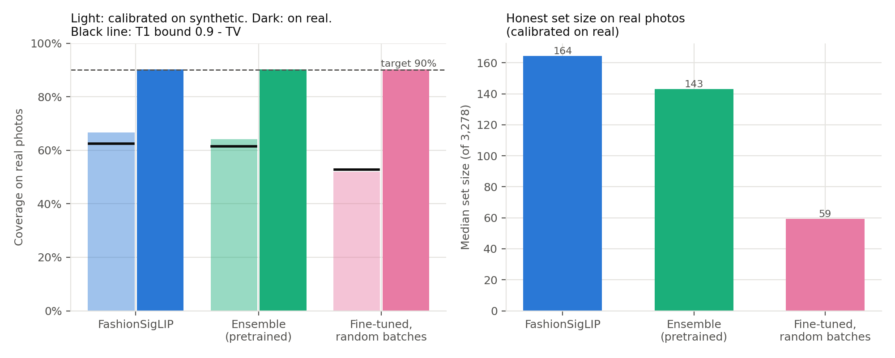
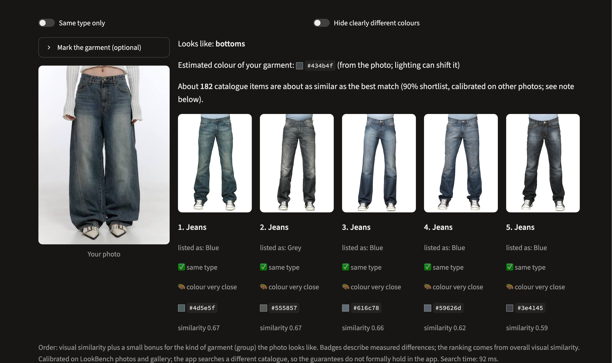

# DAYFIT: find a garment from a photo

You see a jacket on someone in the street, or a pair of jeans in a photo, and you can't describe it well
enough to search for it. DAYFIT lets you search with the photo instead: upload it, and you get the five
most similar items from a shop's catalogue. The app also tells you when it isn't sure, and labels each
result with what it measured (kind of garment, colour) so you can judge the matches yourself.

Course project for EECE 490 (Machine Learning), American University of Beirut, Fall 2026.


*My own sweater, which is not in the catalogue. Top: the whole photo. Bottom: the same photo with the
garment marked (only the red box is searched). Both find similar brown knit sweaters and put the same one
first; marking the garment makes the matches tighter (top similarity 0.71 to 0.74) and removes a beige
sweater from the top 5.*

## What the app shows

For each photo:

- **The 5 closest catalogue items.** The ranking comes from a FashionSigLIP model that we fine-tuned on
  the catalogue. On the demo catalogue it also gives a small bonus to items of the kind of garment the
  photo seems to show (`similarity + 0.05 * P(item's group | photo)`), the version we tested on held-out
  real photos. Kids' items are hidden, and the same product photographed twice is shown only once.
- **A type badge** (`same type` / `different type`): which group the photo belongs to (tops, outerwear,
  bottoms, dresses, footwear, bags, accessories), guessed by the pretrained FashionSigLIP. It only appears
  when the guess is at least 90% confident; then it was right for 98-99% of our synthetic test photos.
- **A colour badge** and the photo's estimated colour (hex code and swatch), next to the shop's own colour
  name ("listed as"). The estimate comes from the photo, so lighting moves it.
- **"Not sure"** when even the best match is weak, and a **shortlist size** ("about N items are as
  similar as the best match"). Both were calibrated on real street photos (LookBench); because the app
  searches a different, much bigger catalogue, they are rough guides there rather than guarantees.
- **"This looks like a skirt; our catalogue has no skirts"** when the photo shows something the shop does
  not sell at all (on the evaluation catalogue this catches 92% of such real photos, with 4% false alarms).
- Two optional filters, *same type only* and *hide clearly different colours*. They hide results; they
  never change the order.
- An optional **crop box** ("Mark the garment") to search only part of the photo, as in the picture
  above. The crop happens in memory; by default the whole photo is sent.

The badges describe differences we measured; they are not the model's reasons. The order comes from
overall visual similarity.

## Two catalogues

| `DAYFIT_CATALOG` | Catalogue | Used for |
|---|---|---|
| unset (default) | `data/catalog.csv`: 6,197 items, 14 types | **every number we report**, and the tests |
| `app` | `data/app_catalog.csv`: **54,178 items**, 68 types | the demo |

All our measurements use the smaller evaluation catalogue (from Kaggle's Fashion Product Images). For the
demo we wanted something closer to a real shop, so the app catalogue adds 26,944 more adult items from the
same dataset (skirts, bags, hats, ...) and 21,037 newer H&M products (2018-20). Each H&M product type was
mapped to one of our existing types before anything was run (a hoodie counts as a sweatshirt, boots as
casual shoes, ...), so the badges and the ranking bonus did not have to be recalibrated; the page still
shows H&M's own name for the product. `curl -s localhost:8000/health` tells you which catalogue is
running (`"catalogue":"app","catalogue_items":54178`).

## Privacy

Uploaded photos are **never stored**. The API reads the photo straight into memory (FastAPI's usual
`UploadFile` would write anything over 1 MB to a temporary file) and logs nothing about it.
`tests/test_api.py` checks that a search writes no file, and in Docker the API runs on a read-only file
system.

## Run it

### On your machine (Mac with Apple Silicon, or anything with Python 3.14)

```
python -m venv .venv
source .venv/bin/activate
pip install torch torchvision
pip install -r requirements.txt
DAYFIT_CATALOG=app uvicorn serving.api:app --port 8000
```

Without `DAYFIT_CATALOG=app` you get the evaluation catalogue. If the page behaves like an older version,
an old server is probably still running on port 8000: `lsof -ti :8000 | xargs kill -9`.

Then, in a second terminal:

```
source .venv/bin/activate
streamlit run serving/ui.py
```

and open http://localhost:8501. You need the catalogues and their images, the fine-tuned checkpoint
(`models/finetuned_random.pt`) and the saved indexes (`models/index/finetuned_random*`). These are
generated or downloaded, not stored in git (see "Reproduce").

### With Docker (CPU only)

```
docker compose up --build
```

The API is on http://localhost:8000/health and the page on http://localhost:8501. The image contains
both catalogues and serves the demo one (`DAYFIT_CATALOG=evaluation docker compose up` for the other).
The build stops early if the saved demo index does not match the catalogue, rather than spending a long
time re-embedding 54k images on the CPU. On a Mac without Docker Desktop, Colima works
(`brew install colima docker-compose`, then `colima start --cpu 4 --memory 8`).

### API

```
curl -X POST --data-binary @photo.jpg http://localhost:8000/search
```

returns JSON with the `results` (rank, item, score, type and colour badges, colour), the `query`
(predicted group, estimated colour, out-of-catalogue warning), `not_sure`, `shortlist_size`,
`latency_ms` and a `note` on the limitations.

## Results

The recommended model is FashionSigLIP fine-tuned on our catalogue with randomly mixed batches.

| Test | Metric | Value |
|---|---|---|
| Synthetic phone photos of the catalogue (294 items), medium / strong | exact item first (Recall@1) | 0.949 / 0.813 |
| Same photos, medium / strong | right article type among the other 5 (P@5) | 0.867 / 0.822 |
| Real street photos (LookBench, 981, duplicate-aware) | exact item first (Recall@1) | 0.520 |
| Same photos | right kind of garment in the top 5 (exact names / groups) | 0.725 / 0.869 |
| Held-out half of the real photos (481), with the group bonus | right kind of garment in the top 5 (groups) | **0.905** (+3.4 points, 95% CI +2.4 to +4.5) |
| Docker on CPU (4 cores), median / 95th percentile | response time | 266 / 282 ms |
| Mac GPU (MPS), median | response time | 36 ms |

The Docker times were measured before the H&M items were added; the extra items should cost very little,
since comparing the photo with every catalogue item is cheap next to running the models.

What we found (details and statistics in `report/results_log.md`):

- **On held-out real photos, the right kind of garment is in the top 5 for 90.5% of photos** (random
  ranking: 21.4%). The bonus that gets us there was chosen on one half of the photos and tested once on
  the other half. Finding the *exact* item first is much harder: about 51%. Most misses are the right
  kind of garment with a different design.
- Fine-tuning helps on real photos: +3.4 points Recall@1 over the pretrained model (p = 0.001), at the
  same speed, and it matches a two-model ensemble at half the cost.
- Our first fine-tuning recipe (batches of the same garment type) made the model worse at telling types
  apart; mixing types randomly in each batch fixed it.
- The "not sure" and shortlist calibration only holds on real photos if it is calibrated on real photos;
  calibrated on our synthetic photos, it covers 52-67% instead of 90%.
- Searching with an ideal type-and-colour menu instead of a photo finds the exact item first in only
  3-5% of cases.
- Things we tried that did not help, and kept in the report: combining with DINOv2 features, re-ranking
  by colour, and a learned "not sure" score.
- LookBench has duplicate pictures, overlapping category names and repeated query crops. We correct for
  all three and the report says which conclusions change.


*How each step of the pipeline does on synthetic phone photos. Row 7 is our first fine-tuned model; the
recommended one (random batches) gets 0.949 / 0.813 and is better at garment types.*


*The shortlist's 90% promise on real photos: broken when calibrated on synthetic photos (light bars),
kept when calibrated on real ones (dark bars).*

## Two more examples


*Light-wash straight jeans: five straight jeans in similar washes.*


*Wide-leg jeans: the right kind of garment and a similar wash, but straighter cuts. The app can only
suggest what the shop sells, and the closest match is not always the same cut.*

## Limitations

- The app can only return what the catalogue sells, so for many photos the best answer is "similar",
  not "the same". Exact-item matching on real photos is about 51%.
- Most of our testing uses synthetic phone photos. The real-photo results come from LookBench, which we
  also used to choose the model; only the group bonus has a clean held-out test. A final test on my own
  wardrobe is planned with its rules fixed in advance (`report/results_log.md`).
- The 90% figure is for 7 broad garment groups.
- "Not sure" and the shortlist were calibrated on a 3,278-item gallery; in the 54k-item app they are
  rough guides, and the shortlist is often in the hundreds.
- The "not sure" signal (the best similarity) is weak: it lowers the error rate mostly by answering less
  often.
- The colour estimate looks at the middle of the photo, so it can pick up a shadow or another garment,
  and lighting changes it.
- **Licence.** Fashion Product Images, LookBench and the H&M data are for non-commercial research only.
  This is a research demo and cannot be sold with these images.

## Repository layout

```
data_prep/    build the catalogues (evaluation, app, H&M), high-resolution images, synthetic phone photos
retrieval/    colour histogram, CLIP / FashionSigLIP retrievers, ensembles
training/     fine-tuning (contrastive, same-type or random batches)
evaluation/   metrics, bootstrap tests, LookBench, conformal methods, analyses, own-photo test (D9)
serving/      search engine, calibration, badges, API, Streamlit page, latency
tests/        unit tests (metrics, statistics, conformal) and API tests
results/      saved result tables (CSV)
report/       results log and figures
```

## Reproduce

```
python -m data_prep.build_catalog
python -m data_prep.hires_catalog --zip data/raw_full/fashion-product-images-dataset.zip
python -m data_prep.make_queries
python -m training.finetune --hard_batches 0 --out models/finetuned_random.pt --log models/finetune_random_log.csv
python -m evaluation.run_eval --method finetuned_random
python -m evaluation.run_lookbench --subset real_streetlook --method finetuned_random
python -m serving.calibrate
python -m serving.badges
python -m serving.outside_check
python -m data_prep.app_catalog
python -m serving.app_badges_check
python -m serving.type_rerank
python -m data_prep.hm_catalog --from_zip data/hm/h-and-m-personalized-fashion-recommendations.zip
python -m data_prep.app_add_hm
python -m evaluation.lookbench_split
python -m evaluation.export_lookbench_features
python -m evaluation.fusion_lookbench --side dev
python -m evaluation.fusion_test_stats
python -m pytest
```

The H&M items are added after the badges, the out-of-catalogue threshold and the bonus were fixed; those
are not recomputed on the merged catalogue.

Data: Kaggle "Fashion Product Images" (catalogue), LookBench (`srpone/look-bench` on Hugging Face, real
street photos) and Kaggle "H&M Personalized Fashion Recommendations" (demo catalogue only; accept the
competition rules first). Pretrained models: Marqo FashionSigLIP and FashionCLIP (DINOv2 was tried, not
used). `evaluation/fusion_test_stats.py` needs the test runs saved first (`fusion_lookbench.py --side test
... --save NAME`, see `report/results_log.md`, Finding 32).
